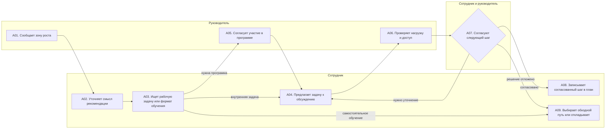

# Анализ процесса AS-IS

## Границы процесса

| Граница | Событие |
|---|---|
| Начало | Руководитель сообщает сотруднику одну зону роста на performance review (A01) |
| Конец | Сотрудник фиксирует согласованный следующий шаг (A08) или откладывает вопрос либо выбирает альтернативу без общего критерия результата (A09) |
| Вне процесса | Подготовка к performance review, выполнение задачи, последующее обсуждение результата, кадровые решения и полное обучение по профессии |

Модель восстанавливает обычный путь от рекомендации к плану действий по открытым
материалам GitLab. Сценарий A09 описывает возможный обходной путь. Обозначения E1–E5
ведут к опубликованным источникам, Д1 и Д2 — к допущениям расчёта.

## Диаграмма процесса

## Шаги процесса

Время в таблице — активное время на шаг в учебном сценарии. Ожидание между шагами
учитывается отдельно. Частота дана на одну зону роста.

| ID | Шаг | Роль | Вход | Выход | Система или канал | Время | Частота | Ожидание | Основание |
|---|---|---|---|---|---|---|---|---|---|
| A01 | Сообщает зону роста | Руководитель | Обратная связь на review | Формулировка зоны роста | Разговор о результатах | 5 мин | Один раз | Нет | E1, Д1 |
| A02 | Уточняет смысл рекомендации | Сотрудник | Формулировка зоны роста | Своё понимание и вопросы | Заметки к разговору | 10 мин | Один раз, подробнее при неясной формулировке | Нет | E1, E2, Д1 |
| A03 | Ищет рабочую задачу или формат обучения | Сотрудник | Зона роста и вопросы | Задача, программа или обучение | Справочник карьерного развития | 15 мин | Один поиск, повтор при смене варианта | Нет | E2, E3, Д1 |
| A04 | Предлагает задачу к обсуждению | Сотрудник | Найденный вариант | Вопрос в повестке 1:1 | Общий документ 1:1 | 5 мин | На каждое предложение | До ответа или встречи | E1, E4, Д1 |
| A05 | Согласует участие в программе | Руководитель | Запрос на участие | Условия и подтверждённое место в графике | Заявка в график программы | 10 мин | Только для варианта в программе | До подтверждения участия | E3, Д1 |
| A06 | Проверяет нагрузку и доступ | Руководитель | Задача и условия | Ограничения, необходимые согласования | 1:1, календарь, заявка | 10 мин | На каждое предложение | До уточнения зависимостей | E3, E4, Д1 |
| A07 | Согласуют следующий шаг | Сотрудник и руководитель | Задача, ограничения и ожидания | Согласованный вариант, уточнение или пауза | Разговор о развитии | 20 мин | Один раунд, повтор при уточнении | Может потребоваться ещё один разговор | E1, E2, E4, Д1 |
| A08 | Записывает согласованный шаг в план | Сотрудник | Договорённость | Запись в индивидуальном плане роста | IGP, Workday или рабочий документ | 5 мин | При согласовании | Нет | E2, Д1 |
| A09 | Выбирает обходной путь или откладывает | Сотрудник | Отложенный или неподходящий вариант | Отдельный курс, наставничество без общей задачи или пауза | Каталог обучения, календарь | 5 мин | Если общая задача не выбрана | До возврата к разговору | E2, Д2 |

## Источники данных

| Код | Что берём в модель | Тип | Источник |
|---|---|---|---|
| E1 | Обсуждение дальнейших действий после review и возможность назначить следующий разговор | Публичная инструкция для руководителей | [GitLab Talent Assessment](https://handbook.gitlab.com/handbook/people-group/talent-assessment/#sample-next-steps) |
| E2 | Планирование развивающих действий, выбор формата и фиксация прогресса в IGP | Публичный справочник по карьерному развитию | [GitLab IGP Guide](https://handbook.gitlab.com/handbook/people-group/learning-and-development/career-development/igp-guide/) · [Career Development and Mobility](https://handbook.gitlab.com/handbook/people-group/learning-and-development/career-development/) |
| E3 | Семь активностей для пробы роли и правила доступа к программе наблюдения за руководителем | Публичное описание программы, включая таблицу рабочих активностей | [GitLab People Leader Shadow Program](https://handbook.gitlab.com/handbook/solutions-architects/sa-practices/sa-leader-shadow/) |
| E4 | Регулярный 1:1 и повестка в общем документе. Пример длительности отдельного слота — 30 минут в одном инженерном подразделении | Публичные регламенты встреч | [GitLab 1-1](https://handbook.gitlab.com/handbook/leadership/1-1/#conducting-a-1-1) · [Пример 30-минутного слота](https://handbook.gitlab.com/handbook/engineering/devops/create/engineering-managers/meetings/#frequency) |
| E5 | Разделение обсуждения развития и административной оценки | Обзор исследований и практические рекомендации | [CIPD, Performance feedback](https://www.cipd.org/globalassets/media/knowledge/knowledge-hub/evidence-reviews/performance-feedback-evidence-review_tcm18-111378.pdf#page=12) |
| Д1 | Активное время на шаг и один дополнительный слот при необходимости устного уточнения | Параметры сценарного расчёта | [Оценка потерь](#оценка-потерь) |
| Д2 | Участник может уйти в самостоятельное обучение или отложить решение при отсутствии общего следующего шага | Гипотеза о развилке. E2 описывает доступные форматы развития | [Обходные пути](#обходные-пути) |

### Семь кейсов

Все семь строк приведены в порядке публикации. Команда разметила содержание карточек
по двум признакам. В M1 учитывается явно названный материал, который можно показать
на обсуждении, например слайд или запись встречи. В M2 учитывается дата, длительность
или прямо указанная повторяемость самого действия. Общие две недели относятся к
программе целиком, а квартальный обзор в C02 задаёт назначение слайда. [Таблица Skills Development](https://handbook.gitlab.com/handbook/solutions-architects/sa-practices/sa-leader-shadow/#skills-development)

| Кейс | Зона роста | Действие в справочнике, кратко | M1. Артефакт | M2. Срок или ритм |
|---|---|---|---|---|
| C01 | Личный пример | Сохранять ответственность за клиентов и проявлять инициативу в контактах | — | — |
| C02 | Развитие команды | Подготовить слайд по итогам ретроспективы, обсудить его и предложить улучшение | Слайд ретроспективы | — |
| C03 | Обратная связь | Участвовать в клиентском созвоне и дать коллеге обратную связь | — | — |
| C04 | Коммуникация | Подключаться к встречам руководителей и участвовать в ведении заметок | Заметки встречи | — |
| C05 | Планирование | Участвовать в обсуждении прогноза и стратегии | — | — |
| C06 | Наставничество | Стать наставником другого архитектора | — | — |
| C07 | Собственное развитие | Выделить зоны роста и обсуждать их с наставником ежемесячно | — | Ежемесячная встреча |

Итого **M1 = 2/7**, **M2 = 1/7**, **M3 = 0/7**. У C02 и C04 найден артефакт,
у C07 — периодичность. После разметки команда использует те же семь строк как
входы для парного прогона ручного подбора и подбора с ИИ.

## Обнаруженные проблемы

| ID | Проблема или риск в текущем процессе | Тип потери | Влияние | Основание и способ проверки |
|---|---|---|---|---|
| P1 | В карточке часто отсутствует явный артефакт для обсуждения результата | Невидимое знание | Участникам приходится дополнительно согласовывать, что показать | Пять строк источника E3 без M1. Проверка — повторить разметку и сверить понимание критерия |
| P2 | Зона роста передаётся рядом с кадровой оценкой, поэтому сотрудник может воспринять пробу роли как обязательную | Точка отказа, потеря мотивации | Сотруднику сложнее сказать, что задача ему не подходит | E1 показывает соседство тем, E5 — основания разделить разговоры. Проверка — наблюдение за отказом в парном сценарии |
| P3 | Если договорённость в конце review неполна, требуется дополнительное уточнение через A04–A07 | Ожидание | Запуск зависит от ответа руководителя и доступности 1:1 | E1, E4, Д1. Проверка — посчитать отдельные созвоны и суммарное время на одинаковых кейсах |
| P4 | Наставничество или обучение может быть выбрано без привязки к одному рабочему результату | Невидимое знание | Есть активность, результат сложно проверить | C07 и варианты E2. Проверка — можно ли связать помощь наставника с рабочим действием и материалом |
| P5 | Формат хранения артефакта зависит от выбранного способа ведения плана и встречи | Дублирование | При итоговом разговоре контекст может оказаться в нескольких документах | E2 допускает разные форматы, E4 ведёт повестку отдельно. Проверка — найти из карточки ссылку на результат |
| P6 | Доступ к пробе отдельных обязанностей зависит от согласования участия и рабочей нагрузки | Точка отказа | Подходящая по навыку задача может оказаться недоступной | В E3 описаны допуск, согласование и доступность. Проверка — пройти случай с ограниченным доступом |
| P7 | Карточка может описывать присутствие на встрече без ожидаемого вклада | Невидимое знание | Завершённое участие легко принять за проявление компетенции | C03 и C05 содержат участие, формат подтверждения вклада не задан. Проверка — критерий должен описывать наблюдаемое действие |

### Обходные пути

Запланировать курс, встретиться с наставником или отложить выбор — возможные ветки
A09. Первый вариант даёт обучение, второй помогает уточнить цель, третий снимает
немедленную нагрузку. Для разбора в учебном прогоне фиксируем, сохранилась ли
связь между зоной роста и рабочим результатом. [Форматы развития GitLab](https://handbook.gitlab.com/handbook/people-group/learning-and-development/career-development/)

## Оценка потерь

В пяти из семи опубликованных описаний отсутствует артефакт для проверки
результата. Это показывает, в каких описаниях нужно уточнить ожидаемый
результат. Частоту отдельных встреч измеряем в пилоте.

В учебной модели сотрудник тратит 15 минут на поиск варианта (A03) и 5 минут
на подготовку предложения к встрече (A04). На согласование (A07) отведено
20 минут. Если на этом шаге стороны по-разному понимают ожидаемый результат,
процесс возвращается к предложению задачи (A04).

> ⚠ Иллюстративный расчёт для одной задачи. Если для повторного согласования
> нужен отдельный получасовой 1:1, это по 30 минут сотрудника и руководителя,
> всего **60 человеко-минут**. Длительность слота взята как ориентир из E4.
> [Шаблон GitLab Meetings](https://handbook.gitlab.com/handbook/engineering/devops/create/engineering-managers/meetings/#frequency)

В парном прогоне на одних и тех же кейсах замеряем суммарное активное время
сотрудника и руководителя от получения зоны роста до согласования или отказа,
а также количество дополнительных обсуждений. Календарное ожидание фиксируем
отдельно.
[План пилота TO-BE](03_tobe_architecture.md#план-пилота)

## Связь с этапом 1

| Проблемы AS-IS | Что из этапа 1 измеряем или защищаем | Ответ в TO-BE |
|---|---|---|
| P1, P4 | M1 и M3. У задачи есть наблюдаемое действие и артефакт | Карточка из каталога и согласованный критерий |
| P3, P6 | M2 и M3. Понятен срок, есть безопасный следующий шаг | Срок и границы согласуются в H1/H2 |
| P5, P7 | M1. Доказательство связано с задачей и используется при обсуждении | Ссылка на результат и обсуждение H3 |
| P2 | Право на отказ и разделение развития с кадровыми решениями | Отказ в H1, прозрачные ограничения доступа и журнала |

[Как моделировать AS-IS, методические указания курса](https://github.com/hrtech2026/hrtech-practice/blob/main/docs/methodology.md#этап-2-as-is)
