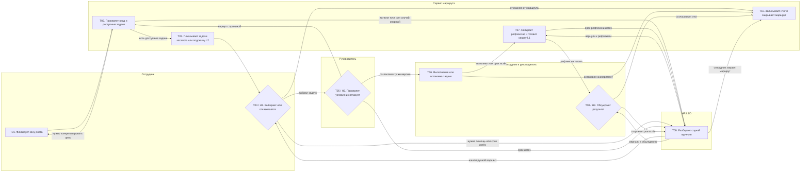
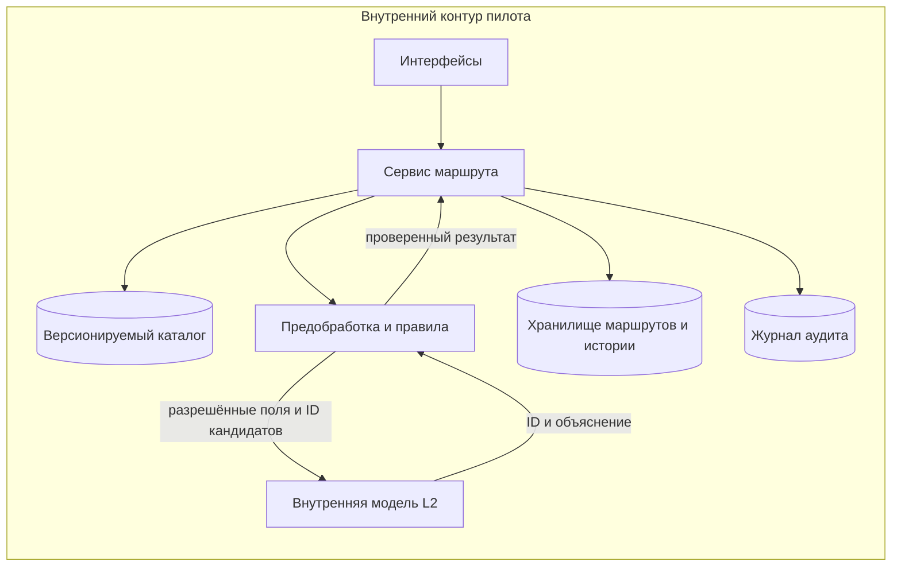

# Целевой процесс и архитектура решения

## Целевой процесс

Сотрудник уточняет зону роста и выбирает рабочую задачу. Руководитель проверяет условия
эксперимента. После выполнения они обсуждают один наблюдаемый результат. Подбор
по каталогу и ручное согласование образуют полный маршрут. Режим L2 добавляет
необязательную подсказку при выборе. [Проблематизация](01_problem.md#противоречие)



### Шаги целевого процесса

| ID | Роль | Вход → выход | Какой разрыв устраняем |
|---|---|---|---|
| T01 | Сотрудник | Зона роста → черновик с уточнённым действием или компетенцией | P1. Сотрудник может уточнить исходную формулировку |
| T02 | Сервис | Роль, зона и ограничения → список действующих допустимых карточек или запрос уточнения | P1, P6. Модель получает допустимые варианты, ограничения проверяются правилами |
| T03 | Сервис | Допустимые карточки → ручной каталог или 2–3 объяснимых кандидата L2 | P3, P4. Сотрудник получает рабочие задачи с результатом и сроком |
| T04 | Сотрудник | Варианты → выбор версии, запрос помощи или отказ через H1 | P2, P6. Старт зависит от явного выбора сотрудника |
| T05 | Руководитель | Выбранная версия → согласование H2, возврат или эскалация | P1, P3, P6. Записываются нагрузка, доступ, срок и критерий |
| T06 | Сотрудник выполняет, любой участник может остановить | Согласованная задача → выполненное действие, результат или остановка | P4, P6. Проба идёт на ограниченной задаче внутри текущей роли |
| T07 | Сервис, ввод сотрудника | Краткий результат, ссылка и вопрос → сводка L1 с источником | P5, P7. Материал доступен из маршрута и связан с согласованным критерием |
| T08 | Сотрудник и руководитель | Сводка и материал → совместный итог H3 или ручная проверка | P2, P5, P7. Участники сверяют вклад с критерием и могут зафиксировать разногласие |
| T09 | HR/L&D | Спор, просрочка или отсутствие подходящей задачи → ответственный и ручной следующий шаг | P2, P3, P6. Маршрут получает владельца, а согласование остаётся за участниками |
| T10 | Сервис | Совместный итог, запрос на закрытие или остановка → сохранённая история маршрута | P2, P5. История показывает основания решений в контуре развития |

Коды P1–P7 относятся к [таблице проблем AS-IS](02_asis_analysis.md#обнаруженные-проблемы).

## Обоснование альтернатив

| Вариант | Сильные стороны | Ограничение | Роль в решении |
|---|---|---|---|
| Ручная карточка и 1:1 | Участники сами трактуют редкие и чувствительные случаи | Требуется отдельный поиск задач, версий и доказательств | Ручное обсуждение T09 и исходный сценарий для сравнения |
| Структурированный каталог и правила | По выбранным роли и компетенции сразу выдаёт действующие карточки. Условия доступа воспроизводимы | При расплывчатой фразе сотруднику сначала нужно выбрать смысл или ответить на вопрос | Основной рабочий режим и контрольный вариант |
| ИИ с подтверждением | Предлагает трактовки свободной формулировки и показывает связь каждой задачи с компетенцией | Возможны неверная трактовка, лишние уточнения и дополнительное время проверки | Режим L2 для неоднозначных формулировок после проверки на учебном наборе |

Когда сотрудник уже выбрал «коммуникация», достаточно каталога: подходят K04 и K08.
Фраза «хочу, чтобы смежники понимали итог после встречи» допускает письменную сводку и
устную презентацию. Правила зададут вопрос о способе коммуникации, а L2 может показать
обе карточки и объяснить, почему сводка ближе к результату «после встречи». Для столь же
общей фразы «хочу лучше руководить» в обоих режимах нужен уточняющий вопрос о поведении.
Эта развилка проверяет, когда ИИ сокращает поиск, а когда лучше сразу спросить человека.
[Открытый пример активности C04](02_asis_analysis.md#семь-кейсов)

## Архитектура решения

| Компонент | Назначение | Ответственность |
|---|---|---|
| Интерфейс сотрудника | Зона роста, варианты, выбор, отказ, рефлексия | Показывает режим подбора и права сотрудника |
| Интерфейс руководителя | Согласование и обсуждение результата | Показывает версию задачи, нагрузку, доступы и критерий |
| Сервис маршрута | Состояния, согласования, сроки и версии | Проверяет права, допустимый переход и версию согласования перед записью |
| Правила и предобработка | Фильтруют задачи, ограничивают вход модели | Проверяют роль, компетенцию, актуальность, границы задачи и поля запроса |
| Каталог | Хранит задания и версии | HR/L&D задаёт компетенцию, действие, артефакт, длительность, доступ и дату актуальности |
| Модуль рекомендаций L2 | Выбирает до трёх ID из переданного списка и объясняет выбор | Возвращает связь с компетенцией, обоснование и вопрос при неоднозначности |
| Сводка L1 | Показывает цель, действие, результат и следующий вопрос | Собирается из полей маршрута и ссылки на материал |
| История и аудит | Показывает ход маршрута участникам и фиксирует события проверки | Хранит авторство, согласованную версию, решения и причину переопределения по ролям |

### Каталог учебного прогона

Карточки используют опубликованные активности C01–C07. Срок и условие приёмки
заданы для учебного прогона. Пилот ограничен внутренними задачами, учебными материалами
и согласованной нагрузкой. [Активности и разметка исходных карточек](02_asis_analysis.md#семь-кейсов)

| ID | Исходный кейс | Действие | Артефакт и критерий результата | Рабочие дни |
|---|---|---|---|---:|
| K01 | C01 | Разобрать с командой пример сопровождения клиента на учебном материале | Памятка с двумя действиями и ответственным за каждое | 10 |
| K02 | C02 | Провести разбор одной ретроспективы и согласовать улучшение | Слайд с одним улучшением, ответственным и контрольной датой | 10 |
| K03 | C03 | Разобрать с коллегой учебный созвон и дать развивающую обратную связь | Краткая запись с одним наблюдением и следующим действием, подтверждённым коллегой | 10 |
| K04 | C04 | Подготовить внутреннюю сводку по итогам встречи смежных команд | Сводка с решением, владельцем и следующим шагом. Владелец подтверждает точность | 10 |
| K05 | C05 | Сравнить два прогноза на учебном примере и обсудить расхождение | Сравнение с одним проверяемым допущением для следующего цикла | 15 |
| K06 | C06 | Провести наставнический разбор рабочей задачи | План следующего действия, согласованный с коллегой | 10 |
| K07 | C07 | С наставником выбрать небольшую задачу для своей зоны роста и проверить результат | Запись с действием, наблюдением и вопросом для следующей встречи | 15 |
| K08 | C04 | Провести короткую демонстрацию решения для смежной команды | Запись решения и следующего шага, согласованных на встрече | 10 |
| K09 | C02 | Вести короткую ретроспективу одного командного процесса | Краткая запись с одним согласованным изменением практики | 10 |
| K10 | C06 | Провести парный разбор типового задания с коллегой | Карточка упражнения и следующий шаг, согласованный с коллегой | 10 |

В тестовом каталоге у задач назначен один владелец HR/L&D. По истечении срока
актуальности карточка исчезает из нового подбора, а у уже согласованного эксперимента
остаётся закреплённая версия. При согласовании T05 сервис проверяет актуальность
новой задачи. Снятый с публикации вариант возвращается на уточнение.

### Состояния маршрута

| Статус | Событие входа | Следующие состояния |
|---|---|---|
| Черновик | Сотрудник сохранил зону роста | На уточнении, Нужна ручная проверка, Отменён |
| На уточнении | Показаны варианты, уточняется цель или пересматривается выбранная карточка | На подтверждении, Нужна ручная проверка, Отменён |
| На подтверждении | Сотрудник выбрал конкретную версию задачи через H1 | Активен, На уточнении, Нужна ручная проверка, Отменён |
| Активен | Руководитель подтвердил ту же версию через H2 | На рефлексии, Отменён |
| На рефлексии | Сотрудник завершил работу или наступил согласованный срок | На обсуждении, Нужна ручная проверка |
| На обсуждении | Сохранена рефлексия и открыта сводка | Завершён, Нужна ручная проверка |
| Нужна ручная проверка | Истёк срок действия, нет допустимой задачи либо возник спор | На уточнении, На рефлексии, На обсуждении, Отменён |
| Завершён | Согласован итог H3 и сохранён следующий шаг | Только чтение до истечения срока хранения |
| Отменён | Сотрудник завершил маршрут без согласования или участник остановил активную задачу | Только чтение до истечения срока хранения |

Рабочий календарь для сроков общий для пилота. Журнал фиксирует решение и версию задачи
в одной операции с изменением статуса. Повтор запроса с тем же ключом оставляет одну
запись. При конкурирующем изменении сервис показывает актуальную версию и запрашивает
повторное подтверждение. Изменение действия, срока, нагрузки, доступов или критерия
возвращает задачу в H1. Следующий эксперимент из H3 начинается с нового выбора.

## Границы контура данных



| Данные | Место обработки | Доступ или передача |
|---|---|---|
| Зона роста и выбранная задача | Хранилище маршрутов | Участники своего маршрута. HR/L&D видит назначенный случай |
| Запрос к L2 | Внутренняя модель | Категория роли, краткая нормализованная зона роста, допустимые ID, описания и признаки карточек |
| Исходный текст review, идентификаторы, оценки, переписка и клиентские сведения | За границей входа модели | Передача блокируется. Для исправления запроса сотруднику показывается инструкция |
| Результат, рефлексия, ссылки на материал | Хранилище маршрутов | Участники и назначенный специалист HR/L&D при разборе. Сводка L1 собирается из этих полей внутри сервиса |
| История маршрута и технический журнал | Два представления с разными правами | Участники видят историю своего маршрута. Технический аудит проверяют аудитор и назначенный владелец пилота |

В пилоте модель работает внутри контура. При недоступности внутренней модели
сервис открывает актуальные карточки каталога. В модели и интерфейсе пилота
нет кадровых интеграций и передачи данных внешнему провайдеру.

## Human-in-the-Loop

| Уровень | Что делает система | Применение |
|---|---|---|
| L0 | Хранит выбранный человеком вариант и его решения | Каталог и ручное согласование |
| L1 | Собирает сводку из полей и ссылок, решение принимают люди | T07 перед H3 |
| L2 | Предлагает варианты из каталога с основаниями, люди проверяют | T03 до H1/H2 |
| L3–L4 | Самостоятельно выполняет действие | В процессе развития не применяется |

Уровень зависит от цены ошибки и обратимости. L2 разрешён при выборе обратимой задачи.
Правила валидируют поля и отправляют напоминания. Уровень кадровых решений выведен
за пределы продукта. Сводка L1 относится к результату рабочего эксперимента.

| ID | Кто, когда и что решает | Право на отказ или возврат | Срок | Эскалация и журнал |
|---|---|---|---|---|
| H1 / T04 | Сотрудник после показа задач выбирает карточку или уточняет её | Может отклонить задачу, запросить ручной разбор или закрыть маршрут. Комментарий необязателен | 5 рабочих дней после показа доступного варианта | При просьбе о помощи или просрочке — T09. В журнале выбор версии, отказ или истечение срока |
| H2 / T05 | Руководитель после H1 проверяет срок, нагрузку, доступ, риск и критерий | Может вернуть задачу с причиной и при наличии предложить другой вариант. Сотрудник заново согласует изменённые поля | 3 рабочих дня с передачи выбранной версии | При просрочке — T09. В журнале исход, версия и основание возврата |
| H3 / T08 | Участники после рефлексии сверяют материал с критерием и выбирают следующий шаг | Каждый может исправить сводку или зафиксировать несогласие | 5 рабочих дней после появления сводки | При споре или просрочке — «Нужна ручная проверка», ответственный HR/L&D. В журнале итог, возражение и следующий шаг |

Для рефлексии после окончания эксперимента выделяются три рабочих дня. Сервис
напоминает один раз за рабочий день до срока H1, H2, рефлексии и H3 при включённых
уведомлениях. При просрочке HR/L&D получает случай и назначает разбор в течение
трёх рабочих дней. Если назначение не состоялось, событие видит владелец пилота.
Истечение срока открывает ручной разбор. Оно не заменяет согласие.

### Пример объяснения

Пример карточки из сценария C04. Фраза в учебном прогоне — «Хочу, чтобы смежники
понимали итог после встречи». [Основание для сценария](02_asis_analysis.md#семь-кейсов)

```text
Вариант K04 — за 10 рабочих дней подготовить сводку одной внутренней встречи.
Признаки: смежная команда, итог и момент после встречи.
Источник: коммуникация в каталоге, карточки K04 и K08.
Основание: K04 даёт письменный итог после встречи. K08 полезен, если нужно
объяснить решение прямо на встрече.
Критерий: владелец подтверждает решённый вопрос, ответственного и следующий шаг.
Вопрос участнику: нужна письменная сводка или обсуждение вживую?
Проверка руководителем: доступ к итогам, согласие участников и нагрузка.
```

Интерфейс показывает «Связь проверена по каталогу» для действующих карточек с
обоснованием и «Требуется уточнение», если смысл двусмысленный. Выход с неизвестным
ID, пустым обоснованием или нарушением ограничения не показывается как подсказка L2.
При единственной подходящей задаче сотрудник видит её в ручном каталоге. При пустом
списке он может открыть T09.

## Риски ИИ и контрмеры

| ID | Риск и сценарий | Контрмера | Как проверяем |
|---|---|---|---|
| R1 | Разный стиль формулировки приводит к разному качеству вариантов | Сопоставляем наблюдаемое действие с карточкой, проверяем роль и допустимость | Парные фразы с одинаковым смыслом дают сопоставимые варианты |
| R2 | Подсказку принимают за приказ или результат передают в кадровую оценку | Видимый режим подбора, право на отказ, разделение контуров, H1–H3 | Сотрудник находит отказ, а состояние и журнал подтверждают выбранный исход |
| R3 | В модель попадают чувствительные поля | Внутренний контур, разрешённый список полей и блокировка до запроса | Тест входа с именем, контактом и клиентским номером |
| R4 | Модель неверно связывает фразу с компетенцией или придумывает задачу | Только действующие ID, проверка обоснования, вопрос и ручной каталог | Тест пустого, недопустимого и неоднозначного результата |
| R5 | Журнал усиливает отчётность, а выполнение подменяет прогресс | Короткая рефлексия, критерий наблюдаемого вклада и H3 | Сопоставляем время участников и сверяем итог с артефактом |
| R6 | Задача устарела или недоступна | Владелец, срок актуальности, версия, проверка перед H2 | Просроченный вариант исчезает из нового подбора |
| R7 | Чужой маршрут, рефлексия или аудит становятся доступны | Ролевой доступ, журнал просмотров, минимальный состав записи | Отрицательные проверки по ролям, попытка изменить запись и проверка удаления |
| R8 | Сбой или повтор запроса оставляет маршрут в неверном состоянии | Ручной режим, атомарный переход, проверка версии и защита от повторов | Недоступность модели и параллельное подтверждение старой версии |

Сознательно принимаем риск R4, что даже проверенная по каталогу обратимая задача
окажется неполезной. Сотрудник может отказаться, руководитель — скорректировать
условия. Итог используется для следующего развивающего шага. Основание для
разделения развития и кадровой оценки приведено в обзоре CIPD.
[Performance feedback, CIPD](https://www.cipd.org/globalassets/media/knowledge/knowledge-hub/evidence-reviews/performance-feedback-evidence-review_tcm18-111378.pdf#page=12)

## Логирование и аудит

```text
decision_id, timestamp, route_id, route_revision, actor_key, actor_role,
event, from_status, to_status, checkpoint, task_id, task_version,
catalog_version, model_version, input_ref, input_hash, candidates,
reason_code, escalation_state, retention_deadline
```

`input_ref` ведёт к версии разрешённых полей. `input_hash` рассчитывается по этой
версии и позволяет сверить, какой вход использовался. Полный текст review, рефлексия
и свободный текст отказа в техническом журнале отсутствуют. Исправление оформляется
новым событием. Запись просмотра технического аудита тоже сохраняется.

Сотрудник видит историю своего маршрута, руководитель — историю маршрута, в котором
он участвует. Специалист HR/L&D видит назначенный случай, аудитор и назначенный
владелец пилота — технический журнал в пределах пилота. Маршрут, история и журнал
хранятся 90 календарных дней после закрытия. По истечении срока удаляются записи
и версии входов по этому маршруту. В обезличенной сводке пилота остаются только
итоги замеров без связи с участником.

## План пилота

1. На карточках C01–C07 провести ручной подбор по каталогу и подбор с L2 по
   одним и тем же исходным формулировкам. В каждом режиме участник и руководитель
   проверяют применимость задачи, артефакт и срок. Порядок режимов чередуется.
2. Посчитать M1–M3. Записать долю кейсов с пригодной задачей по совместной проверке
   и суммарные активные минуты сотрудника и руководителя от зоны роста до
   согласования или отказа. Отдельно замерить время на рефлексию.
3. Включать L2 для пилота, если пригодных решений не меньше, чем в каталоге,
   и либо медиана суммарного активного времени до решения ниже, либо хотя бы
   в одном кейсе появилось пригодное решение, которого не было при подборе по
   правилам. Для всех режимов действует цель M3 не ниже 6/7 и проверка
   обязательного согласия.
4. Провести один маршрут на 10–20 рабочих дней. На итоговом обсуждении проверить,
   помогает ли журнал найти материал, можно ли безопасно возражать и занимает ли
   краткая рефлексия до 10 минут. Опрос до и после задаёт одинаковые вопросы о
   возможности отказаться, изменить задачу и сообщить о трудности.

Условия старта — назначены владелец каталога и участники H1–H3, проверены актуальность
карточек и права, есть ручной маршрут. При нарушении контура данных либо показе
недопустимой задачи владелец пилота отключает L2. Ручной маршрут остаётся
доступен. При признаках давления на участника пилот пересматривает порядок
показа истории и обязательные поля, прежде чем продолжить.

[Методические указания к этапу 3](https://github.com/hrtech2026/hrtech-practice/blob/main/docs/methodology.md#этап-3-to-be-и-human-in-the-loop)
